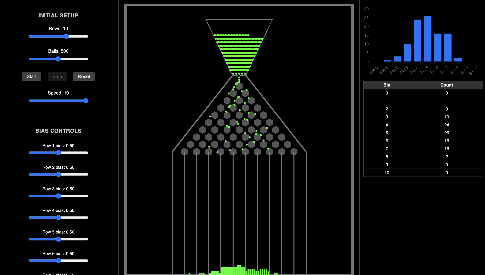

# Galton Board Simulation

A browser-based Galton board (bean machine) that demonstrates how random events can generate a normal distribution. Adjust the number of rows, number of balls, per-row biases, and animation speed, then watch the beads fall, settle into bins, and update a real-time histogram.



---

## Features

- **Interactive controls**
  - Rows: 1–15
  - Balls: 10–1,000
  - Adjustable drop speed
  - Start, stop, and reset simulation

- **Bias sliders**
  - Set a probability bias (left/right) for each row  
  - Option to randomize them all

- **Real-time statistics**
  - Histogram rendered with Chart.js
  - Table of bin counts

- **Responsive three-panel layout**
  - Pure CSS, works on desktop and mobile

---

## Getting Started

Clone or download the repository.  

Open `index.html` in any modern browser, or serve the project locally:

```bash
# Using Python 3
python -m http.server 8000
# then visit http://localhost:8000/
```
